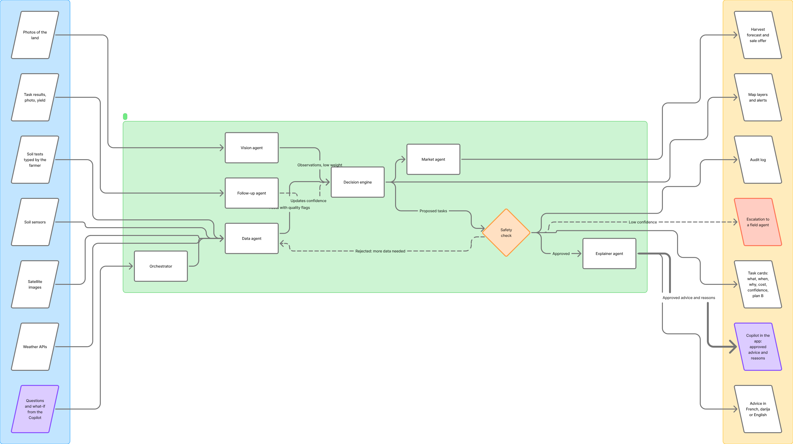

# Farm Advisor

**An AI that reads your land and tells you what to do, when, and why. Then it follows up.**

BCG Platinion Hackathon 2026 - Fighting World Hunger - Team 2

> A hackathon prototype with a working web app, API, rule engine, sensor and satellite layers and tests.
> The status of every part, real or simulated, is in the table further down.

---

## Repository layout

| Folder | What it is |
|---|---|
| [`frontend/`](frontend/) | The farmer's web app, **growmate** (Next.js, React, TypeScript, Tailwind): picture-first onboarding, My Farm with the engine's "do this now" card and the land maps, Co-Pilot (voice, photo), Activities. English, French, Arabic and Darija. |
| [`backend/`](backend/) | The API (FastAPI, SQLite, migrations): decision engine, Copilot, voice routes, and under `app/processing/` the engine, the **sensor layer** (simulator, quality checks, drift, sentinel offset) and the **satellite layer** (indices, anomaly detection, zones). Tests in `backend/tests/`, demos in `backend/scripts/demos/`. |
| [`docs/`](docs/README.md) | Architecture, API contract, sensors, voice, Darija, the plan to bring the engine to the app. |
| `.github/workflows/` | Checks that run on every push: backend tests and API contract, front-end type check, Darija check and build. |

## Run it

```bash
# 1. the API (http://127.0.0.1:8000, documentation at /docs)
cd backend && ./run.sh

# 2. the app (http://localhost:3000), in another terminal
cd frontend && cp .env.example .env.local && npm ci && npm run dev

# or everything at once with Docker
docker compose up --build
```
Optional keys (a language model, Azure speech) go in `backend/.env`, see `backend/.env.example`. Checks before a pull request: `make check`
(see [CONTRIBUTING.md](CONTRIBUTING.md)).

## The problem

Small farmers often decide by instinct: when to irrigate, how much fertilizer to apply, when to check a field.
A wrong call can cost a harvest, and the advice that exists is either general ("water your crops") or tied to
expensive equipment that smallholders cannot afford.

For scale, an FAO estimate from 2011 puts crop losses in Sub-Saharan Africa above 30% of production, mostly before
the produce leaves the farm. It is old data: read it as an order of magnitude, not a current figure.

## The idea

Farm Advisor combines what is already available for free or at low cost:

- **Satellite images** (Sentinel-2) for crop vigor, zone by zone;
- **Weather forecasts** (Open-Meteo);
- **A few shared soil sensors** per village, used as calibration points for the neighbours who have no sensor;
- **Soil tests** typed by the farmer from a lab report or their own sample;
- **Photos** of the land.

It then gives **one clear action at a time**, always with:

| | |
|---|---|
| **What** | for example "Irrigate zone D, 25 mm" |
| **When** | a precise window, set around the forecast |
| **Why** | one plain sentence with the numbers behind it |
| **Cost** | what it takes, for example pump time or kilos of fertilizer |
| **Confidence** | high, medium or low, with the reason, and what would raise it |
| **Plan B** | what to do if the farmer cannot follow the advice |

Then the farmer marks the task done, adds a photo and the result, and the next advice uses what really happened.

## How it works

```
 INPUTS                      SANDBOX (isolated, allow-listed tools)               OUTPUTS
 satellite images  ---+
 weather APIs      ---+--> Data agent --> Decision engine --> Safety check --> Task cards
 soil sensors      ---+          ^              ^   |              |  \         Map layers and alerts
 soil tests        ---+          |              |   |              |   \        Harvest forecast, sale offer
 photos ----> Vision agent ------+--------------+   |              |    +-----> Copilot in the app
 task results ---> Follow-up agent (updates confidence)             |           Advice in FR, darija, EN
 questions from the Copilot ---> Orchestrator                       +---------> Escalation, audit log
```



*Inputs on the left, the sandbox with its agents in the middle, outputs on the right. The Copilot is both an output (it receives the approved advice and reasons) and the source of the farmer's questions, which go back to the orchestrator.*

Design rules:

1. **Code decides the numbers, a language model only explains.** Doses, dates and quantities come from a tested
   rule engine (water balance, caps). A model never invents a number, and a check rejects any text containing a
   number that is not in the facts.
2. **Every piece of advice says how sure it is** and what would make it surer (a soil test, a sensor reading).
3. **A sandbox limits what agents can do:** allow-listed tools only, no secrets, limits on time and memory, and
   no direct write to the farmer's data. Agents return proposals, and only the safety check can approve them.
4. **Photos are described, never diagnosed.** The vision agent reports what is visible and what to check.
5. **Works offline.** Once opened, the website keeps working: data is cached on the device and actions are queued,
   then sent when the connection returns. Without any language model, the app still shows the engine's full advice.
6. **Honest labels.** Simulated data is labelled as simulated, in the app and here.

## Where the team's AI sits

| Agent | Job | Language model? |
|---|---|---|
| Orchestrator | Routes each request, stops loops | Small model or plain code |
| Data agent | Collects satellite, weather, sensors, soil tests and checks their quality | No |
| Vision agent | Describes a photo (visible symptoms, location, confidence) | Yes, multimodal |
| Decision engine | Computes what, when, how much, cost, confidence, plan B | No (rules, tested) |
| Safety check | Approves or rejects each proposal: caps, consistency, number check, escalation | No (code) |
| Explainer agent | Writes the advice in the farmer's language | Yes |
| Market agent | Harvest forecast and sale offers | Optional |
| Follow-up agent | Learns from results and photos, schedules the next check | Optional |

The in-app **Copilot** receives only the approved advice, the reasons and the facts behind them. It can explain,
simulate "what if I wait two days?" (by asking the engine again), translate, and ask for more data. It cannot change
a task or state a number that is not in the facts.

## Status: what is real, simulated and planned

| Part | Status |
|---|---|
| Decision engine (irrigation, fertilizer, inspection, alerts, soil-test effects) | **Built**, rule based, tested |
| API (state, tasks, soil tests, Copilot, voice, sync, farmer profile, place names) with a typed, frozen contract | **Built**, 100 automated tests |
| Sensor layer: simulator, quality checks (spikes, jumps, plateaus, rain consistency, frozen soil), drift detection, sentinel offset per plot | **Built and tested** on **simulated** data |
| Satellite layer: vegetation indices, anomaly detection with a learned baseline, management zones | **Built and tested**; **real Sentinel-2 data** only for the demo parcel near El Jadida, downloaded by a script |
| Team web app: onboarding (six picture questions), My Farm, land maps (photo, measure, 3D), Co-Pilot, Activities | **Built** |
| Engine inside the web app: Co-Pilot answers, the "do this now" card with undo, the profile sent to the engine, answers kept offline | **Built** (branch work, see [the plan](docs/ROADMAP-TEAM-FRONTEND.md)) |
| Languages: English, French, Arabic, Darija | **Built**; Darija and Arabic texts are not reviewed by a native speaker yet |
| Voice | Browser voice in the web app; Azure speech (server side) tested in the backend; not in the web app yet |
| Weather and 5-day forecast | **Real** (Open-Meteo, cached, with a labelled fallback) |
| Field of the farmer | **Not yet**: the engine works on the demo parcel until the farmer's own field is processed |
| Soil-moisture sensors, buyers, offers and prices | **Simulated** |
| Crop type and harvest forecast | **Placeholder**: a satellite shows vigor, not the species; the forecast is not validated |
| Rule thresholds (vigor target, fertilizer band, moisture trigger) | **Demo values**, to be calibrated on real fields |
| Orchestrator, vision agent, explainer agent, sandbox isolation | **Designed, not built** |

## Technology

- **Back end:** Python, FastAPI, SQLAlchemy and Alembic (SQLite for the demo), pytest
- **Front end:** Next.js 15, React 19, TypeScript, Tailwind 4; MapLibre and Leaflet for the land maps
- **Satellite:** Sentinel-2 L2A through the free Earth Search STAC catalog (only the field's pixels are downloaded)
- **Weather:** Open-Meteo (no account needed)
- **Voice:** the browser's speech, and Azure AI Speech on the server
- **Models (optional):** a hosted model or a local one, only to word answers; the engine's own texts are used when none is configured

## Next steps

The step-by-step plan is in [docs/ROADMAP-TEAM-FRONTEND.md](docs/ROADMAP-TEAM-FRONTEND.md): the activities teach the engine, the farmer's own
field with its satellite zones, confidence and data quality shown to the farmer, Azure voice and talk mode, offline, one farmer per phone,
a professional visual pass, Azure deployment, and hardening with real-phone tests.

## Limits and disclaimer

This is a hackathon prototype. Data are partly simulated, thresholds are demo values and the harvest forecast is not
validated. **It is not agronomic advice for real fields.**

## Team

Team 2 - BCG Platinion Hackathon 2026.
