# Sanabils (سنابل): the idea, what we are building, and the sandbox

BCG Platinion Hackathon 2026, theme "Fighting world hunger", Team 2. State on 17 October 2026.
Diagrams are written in Mermaid (rendered by GitHub); PNG copies are in `docs/diagrams/`.
For the detailed structure and the justification of each choice see [`TECHNICAL.md`](TECHNICAL.md).

## 1. The idea

**Sanabils** tells a small Moroccan farmer **what to do today, why, how sure we are, and the plan B**, by voice, in Darija, Arabic, French or English, on a cheap phone that is often offline.

It reads the land for him: real Sentinel-2 satellite vigor, Open-Meteo weather, soil sensors if he has them (otherwise a rain / ET0 water balance), and his own soil tests. **The code decides every number; the AI only explains**, and everything on the screen is labelled real, simulated or not validated. It then follows up (Done, Can't and why, how does it look), so the advice learns from the field.

Why it matters for the theme: on small farms the lever is water and fertiliser used at the right moment; one wrong decision costs a season's income, and the farmer most exposed is the one who reads little and has no agronomist.

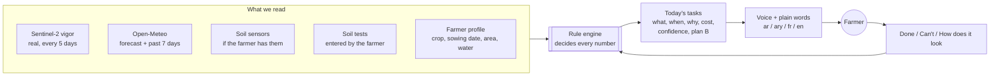

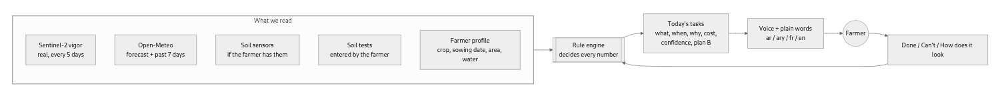

## 2. What we are building (what exists today, on `main` and on Azure)

| Part | What the farmer gets |
|---|---|
| **Landing + onboarding by voice** (`/`, `/start`) | 8 questions answered by speaking, pictures or typing; the field found on a map |
| **Simple mode** (default: `/today`, `/field`, More) | The land as A / B / C / D; tap a zone to **hear what to do there**; one big card in plain words; Done / Can't; Speak; Listen to today; Call my advisor. No numbers unless asked |
| **Full mode** (Home, Field, Tasks, Sell, Alerts, Me) | Layers (vigor, moisture, temperature, anomalies), tasks with why / cost / confidence / plan B / what-if, season plan, prices, alerts |
| **Setup** (`/setup`) | Sensors or satellite-only, connection mode, advisor phone, simple or full, look, keep for offline |
| **Engine** | Tasks, season plan, per-task verifier (confirmed / adjusted / escalated), daily briefing, water balance without sensors |
| **Voice** | Azure AI Speech on the server (TTS + STT) in the four languages; browser voice as fallback |
| **Copilot** | Facts → intent → engine draft → optional model rewrite → **number check**; today in engine mode (no model key configured) |
| **Offline** | Installable PWA; reads cached with their age; writes queued and replayed through `/api/sync` |
| **Delivery** | Two Docker images, CI green, CD pipeline built (waiting for one Azure role) |

### 2.1 The farmer's journey

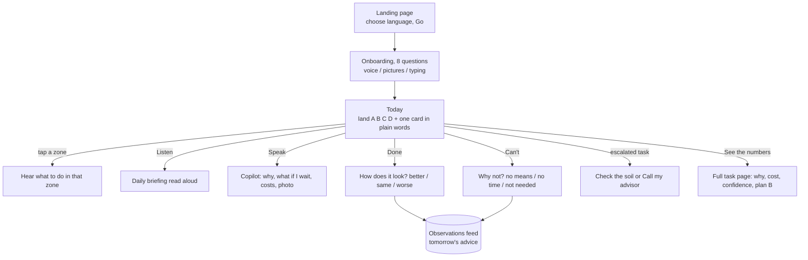

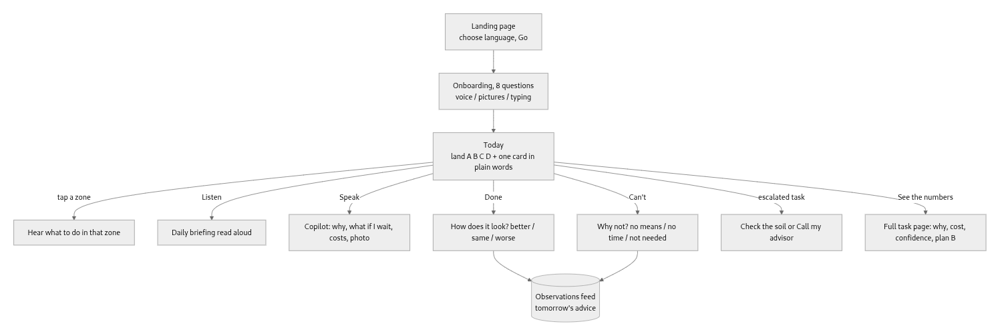

### 2.2 How a task is decided, verified and spoken

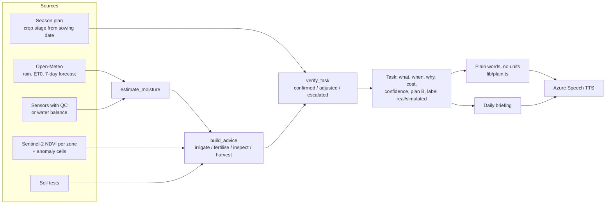

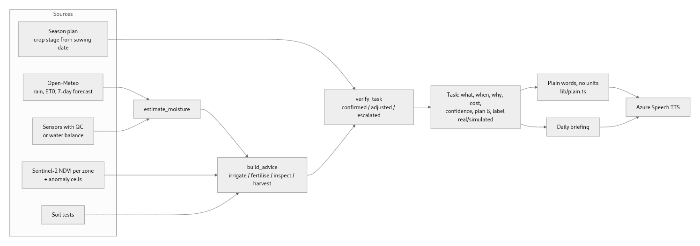

### 2.3 Where the AI is, and where it is not

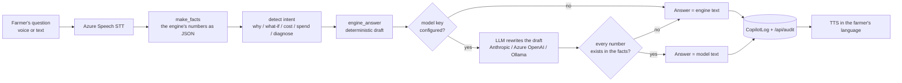

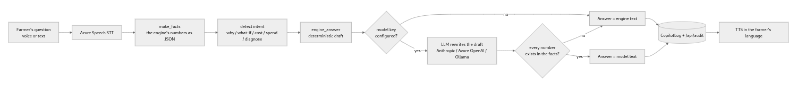

Rules: the model never produces a number, never calls a tool, never writes to the database; without a key nothing is simulated, the engine answers.

## 3. The sandbox (Azure)

Subscription `AZ-EUR-PlatinionHackathon-Dev`, resource group `CASA-team-2`. Our account is **Contributor** (can create and update resources) and not Owner (cannot grant roles): that is the one reason push-to-deploy is still manual.

| Resource | Type | What it is | Ours |
|---|---|---|---|
| `farm-final-api` | Container App | the FastAPI backend, image tagged by commit (`832d931`) | yes |
| `farm-final-web` | Container App | the Next.js app, the public URL | yes |
| `farm-advisor-speech-casa2` | Azure AI Speech (France Central) | the voice, TTS + STT | yes |
| `growmate-github` | Managed identity | what GitHub signs in as for CD; trusted, waiting for 3 roles | yes |
| `growmateacr2026` | Container Registry | our images (`farm-final-api:<commit>`, `farm-final-web:<commit>`) | shared |
| `growmate-env`, `growmate-logs` | Container Apps environment, Log Analytics | runtime and logs | shared |
| `frontend` | Container App | the team's earlier app (GrowMate) | team |
| `stgrowmate…` | Storage account | from the earlier setup | team |

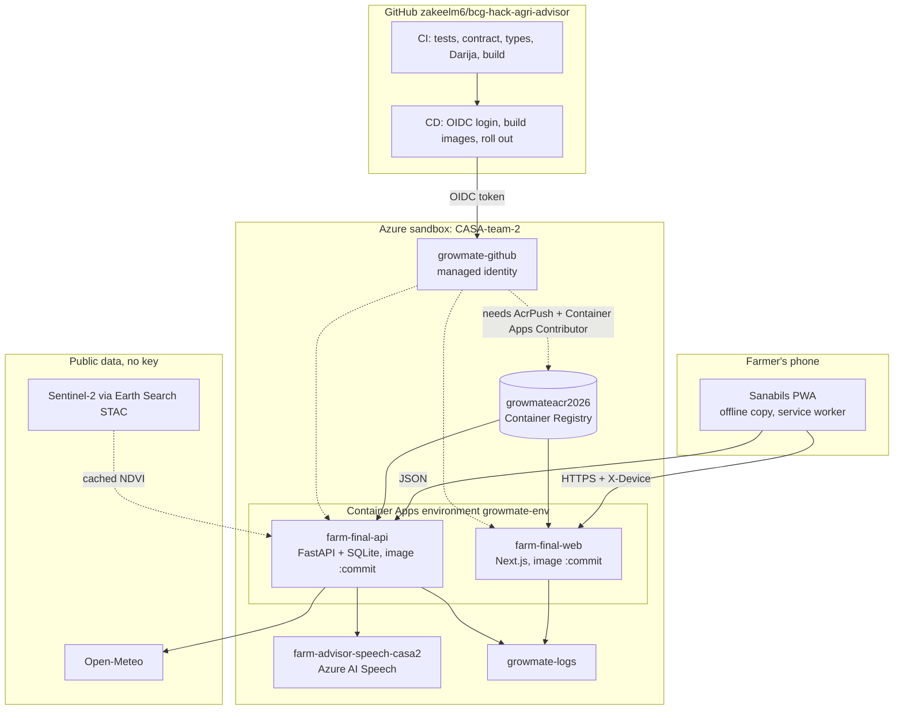

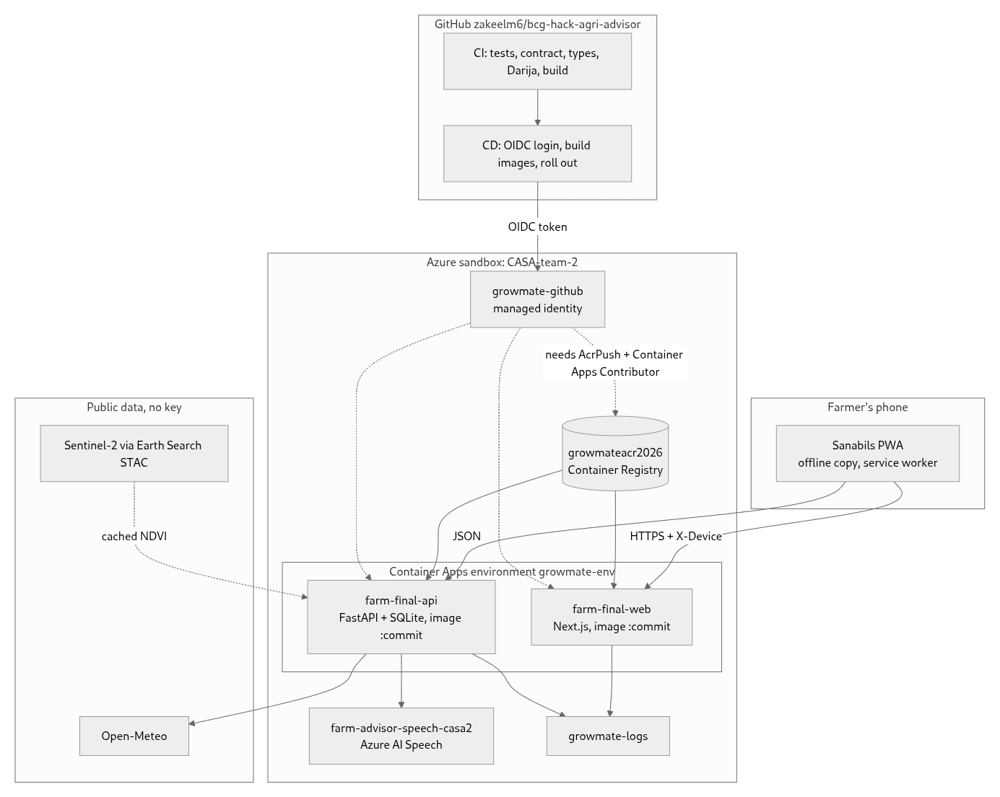

### 3.1 From a push to the farmer's screen

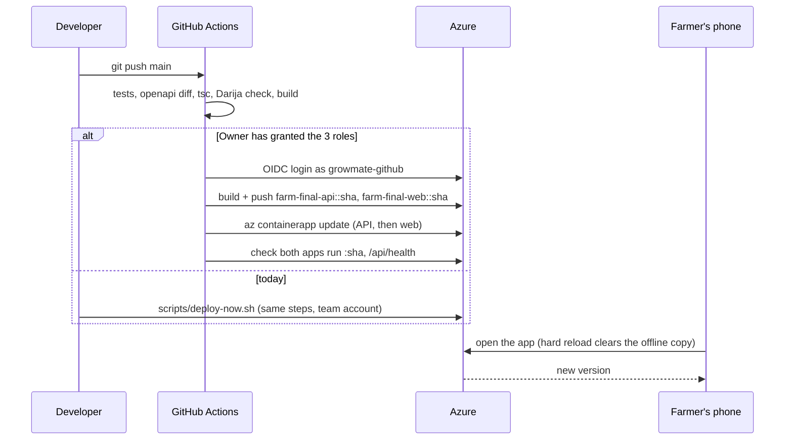

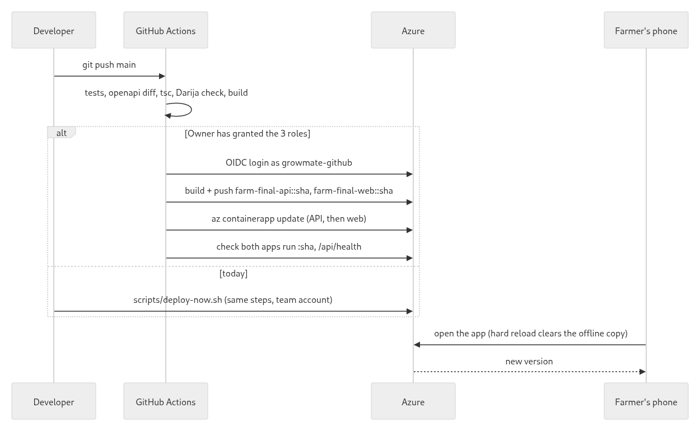

## 4. Open decisions for the last stretch

1. **Language model on or off for the demo.** On: an Azure OpenAI deployment and key (about 1 h), optionally the Copilot wrapped as a LangGraph graph with the number check as a node (about 3 h). Off: honest, already works, every text comes from the engine.
2. **Pipeline.** An Owner runs `scripts/azure-grant.sh` (30 s), or the deploy job runs on a team laptop as a self-hosted runner.
3. **Demo rehearsal** on a real phone, in noise, with a native Darija speaker; demo script.
